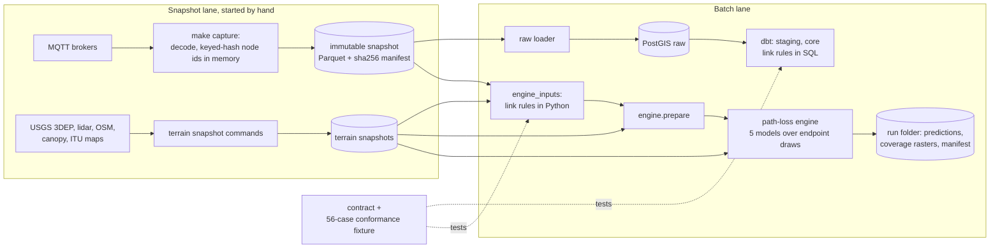

# mesh-terrain

Can public Meshtastic radio data tell us which radio propagation model best predicts link quality over real terrain? This project captured public mesh traffic across the St. Louis metro from 2026-10-22 to 2026-10-25, built a pipeline and a terrain-aware path-loss engine to answer that, and found that passive public data cannot answer it. The pipeline, the engine and the reasons are the result. [`docs/findings.md`](docs/findings.md) has the findings; this page says what was built and how to run it.

Meshtastic is an open-source mesh network of small LoRa radios (low-power, long-range radios in the 915 MHz band). Some nodes, called gateways, forward the packets they hear to an internet MQTT broker, a message server that other programs subscribe to; the public broker can be read by anyone, and the MeshSTL community broker by its members. Each forwarded packet carries the received signal strength (RSSI) and signal-to-noise ratio (SNR) of the last radio hop. A propagation model predicts how much signal is lost between two points (the path loss); comparing predictions with those readings is the test.

## What was built

The diagram has two lanes: the snapshot lane, where a person starts each capture or download, and the batch lane, which builds everything else from the snapshots. Dagster, the orchestrator, runs the batch lane's warehouse steps.



- **Capture and pseudonymisation.** `make capture` records one MQTT capture on demand; nothing is scheduled. It decodes the packets (protobuf, a binary message format) and replaces every node id with a keyed hash (HMAC-SHA-256) in memory, before anything is written to disk (ADR 0005; an ADR is a decision record in `docs/adr/`). The one capture snapshot so far was reduced from the Phase 1 spike's raw archive, which held real ids until it was deleted on 2026-11-14 (ADR 0003); no real node id exists in the snapshot or the warehouse. Each input, capture or terrain download, is an immutable snapshot with a sha256 manifest.
- **A contract and a conformance fixture.** A link-hour is one directed radio link, from the node that last transmitted a packet to the gateway that heard it, in one clock hour. The rules for building link-hours (which radio hop a reading belongs to, which positions count, when a link-hour is kept) are written once in [`docs/data-quality-contract.md`](docs/data-quality-contract.md), which holds 33 rules, each named by an id such as `lnk_02`. The link and position rules among them are pinned by a hand-worked fixture of 56 cases.
- **Two implementations.** The link rules run in SQL (dbt models in PostGIS) and in Python (`ingester/link_rules.py`). Both pass the fixture. On the real capture, with one failing staging test excluded, they keep the same link-hours and pairs; they differ slightly at the receipt level, recorded in the findings.
- **Warehouse.** PostgreSQL 17 with PostGIS 3.5 and h3-pg (the H3 hexagonal grid in SQL), dbt for models and tests, Dagster for orchestration (ADR 0001). The tests connect as a role that cannot write the raw schemas at all.
- **Path-loss engine.** One command and one config file take up to five terrain snapshots, transmitter sites and receiver points, and write predictions, coverage rasters and a manifest. It runs five models: free space, knife-edge diffraction over the terrain profile, Okumura-Hata, the Longley-Rice Irregular Terrain Model (ITM, built from NTIA's public-domain reference code) and ITU-R P.1812. A real position is a box, not a point, so each link is predicted over random draws of both endpoints inside their boxes (16 in the runs so far), with a GPS error floor set in the config (5 m either side of the centre in the runs so far; ADR 0009). The contract is [`docs/INTERFACE.md`](docs/INTERFACE.md).
- **Provenance.** Every engine run's manifest records the code commit and whether the checkout was clean, the sha256 of every input layer and terrain snapshot manifest, the model library hashes, the seed and the versions of the manifest, the engine and the output columns. A run from a clean checkout (`make engine` refuses any other) can be traced to exactly what produced it.
- **Privacy.** Node ids are pseudonymised at the source. Precise positions from the community broker are never published. The engine admits a point layer only if it is marked synthetic, or marked real and listed by the preparation step with a matching sha256; this stops accidents, not a deliberate bypass. Run outputs from real data stay on the owner's machine; what is published from real data is counts and one coarse statement, described below.
- **Security.** Every published port is bound to this machine only. `make up` refuses to start the stack with placeholder credentials. Real credentials are generated per machine and never committed; the test role's two values are kept out of test reports. The details are in [`docs/operations.md`](docs/operations.md).

## Run it on synthetic data

You need Docker with Compose v2, GNU Make, [uv](https://docs.astral.sh/uv/) 0.13 (it installs Python 3.12 if missing), Git and `openssl`. On Windows, run everything from Git Bash (Running on Windows, below). These are the steps a fresh clone of the repository ran, with its own Compose project name: `make up` took about 4 minutes building the images, `make check` about 25 minutes.

```
git clone https://github.com/Caseykelly87/mesh-terrain.git
cd mesh-terrain
cp .env.example .env
# generate the stack's credentials in .env without printing them
for name in WAREHOUSE_PASSWORD MINIO_ROOT_USER MINIO_ROOT_PASSWORD; do sed -i "s|^${name}=.*|${name}=$(openssl rand -hex 24)|" .env; done
# a database role for the tests, with a distinctive name
sed -i "s|^# WAREHOUSE_TEST_USER=.*|WAREHOUSE_TEST_USER=tester_$(openssl rand -hex 6)|; s|^# WAREHOUSE_TEST_PASSWORD=.*|WAREHOUSE_TEST_PASSWORD=$(openssl rand -hex 24)|" .env
# the data folder lives beside the checkout, never inside it
mkdir -p ../mesh-terrain-data/snapshots ../mesh-terrain-data/runs
make up       # builds and starts PostGIS, the object store and Dagster
make check    # lint, types, about 1 850 tests and the dbt build, all on synthetic data
make engine CONFIG=engine/fixtures/fixture-run.yaml SNAPSHOTS_HOST_DIR="$PWD/tests/fixtures/snapshots"
make down     # stops the stack; the data is kept
```

The engine run writes `../mesh-terrain-data/runs/fixture/`: predictions, coverage rasters, a run report and a manifest recording the commit it ran from.

Notes:
- Ports 5433, 9000, 9001 and 3000 must be free; every one is bound to this machine only.
- Behind an antivirus or proxy that re-signs HTTPS, set `SSL_CERT_FILE`, `REQUESTS_CA_BUNDLE` and `CA_BUNDLE_PATH` in `.env` to its CA bundle (Running on Windows, below).
- A second copy of the project on the same Docker host needs its own `COMPOSE_PROJECT_NAME` in `.env`, and must never run `make nuke`, which always acts on the `mesh-terrain` project's volumes.

The committed fixture run draws this coverage map: predicted knife-edge path loss at 906.875 MHz from one synthetic site over a synthetic 1 km terrain tile. Nothing in it is real.


| Colour | Path loss, dB |
| --- | --- |
| yellow `#fde725` | below 60 |
| light green `#90d743` | 60 to 70 |
| green `#35b779` | 70 to 80 |
| teal `#21918c` | 80 to 90 |
| blue `#31688e` | 90 to 100 |
| indigo `#443983` | 100 to 110 |
| dark purple `#440154` | 110 or more |
| transparent | no value |

Free space at this frequency loses about 92 dB at 1 km, so the darkest cells are where the synthetic terrain blocks the path. How the figure is made, and the check that refuses a run whose site or receiver layer is not synthetic: [`web/README.md`](web/README.md), whose caption table this copies.

### Credentials

`.env.example` holds placeholders for the warehouse owner's password and the object store's root user and password, which anyone can read in this repository, so never keep them. `make up` refuses to start while any of them is empty or a placeholder; the command in the steps above generates all three. Changing a password later, and how the owner's password is rotated without locking it out: [`docs/operations.md`](docs/operations.md), Credentials.

### Test role

The tests and the development dbt builds connect as a second database role, named by `WAREHOUSE_TEST_USER` and `WAREHOUSE_TEST_PASSWORD`, which cannot write the raw schemas. Only the main checkout's `.env` sets them. A check in a git worktree takes those two values from the main checkout's `.env` and nothing else, in the same command as make, so they are never printed or copied:

```
while IFS= read -r line; do export "$line"; done < <(grep -E '^WAREHOUSE_TEST_(USER|PASSWORD)=' "$(git rev-parse --path-format=absolute --git-common-dir)/../.env" | tr -d '\r') && make check DBT_DEV_TARGET=dev_ta
```

The rest, including what can still show a value and why: [`docs/operations.md`](docs/operations.md), Test role.

## Real versus synthetic

| Real, kept on the owner's machine | In this repository |
| --- | --- |
| The MQTT capture, 2026-10-22 to 2026-10-25, pseudonymised | Every test fixture and the conformance fixture, all synthetic |
| Terrain snapshots: USGS 3DEP, lidar, OpenStreetMap, canopy height, ITU maps (public sources, downloaded by make targets) | The engine fixture run and the coverage map above, synthetic |
| Engine runs on real positions | The metro boundary seed, real public Census data |

Published from real data: counts (the funnel in the findings) and one coarse statement about the one link checked, which names no node, place, time or value.

## Limits

- A single capture from 2026-10-22 to 2026-10-25, in one metro.
- 8 pairs with a kept link-hour, and one link-hour inside the terrain tile built at 1 m resolution.
- Public positions are blurred to boxes of about plus or minus 364 m at best; transmit power and antennas are unknown; packets too weak to decode are never seen.
- The engine is tested against published reference values and a synthetic fixture, not against a controlled measurement. A drive test with known radios is the first item on the roadmap ([`docs/ROADMAP.md`](docs/ROADMAP.md)).

## Where to look

| Path | What |
| --- | --- |
| [`docs/findings.md`](docs/findings.md) | The result |
| [`docs/PLAN.md`](docs/PLAN.md) | The original plan, phases and data model |
| [`docs/STATUS.md`](docs/STATUS.md) | Where the project actually stands |
| [`docs/ROADMAP.md`](docs/ROADMAP.md) | What comes next |
| [`docs/adr/`](docs/adr/) | One file per decision |
| [`docs/operations.md`](docs/operations.md) | Running the stack day to day: credentials, the test role, the snapshot and engine targets, Windows |
| `ingester/`, `pipeline/`, `dbt/`, `terrain/`, `engine/`, `web/` | Each has a README |

How the work was organised and reviewed: [`CONTRIBUTING.md`](CONTRIBUTING.md).

## Running on Windows

Use Git Bash, Docker Desktop with the WSL 2 backend, GNU Make and uv; never PowerShell for make. Line endings, file sharing, the warehouse port, and the CA bundle needed behind an antivirus or proxy that re-signs HTTPS: [`docs/operations.md`](docs/operations.md), Running on Windows.

## Data credits

Elevation and lidar: USGS 3DEP (public domain). Canopy height: High Resolution Canopy Height Maps by WRI and Meta, version 2, released under CC BY 4.0 on the AWS Open Data registry and under the DINOv3 licence by its authors; both apply and both are carried into every map that uses it. Buildings and roads: © OpenStreetMap contributors (ODbL). Boundary: US Census TIGER. ITM: NTIA's reference implementation (public domain). Meshtastic packet data: a single capture from 2026-10-22 to 2026-10-25 from the public broker and the MeshSTL regional broker under their terms of use, held privately; only aggregated, pseudonymised derivatives are published.
