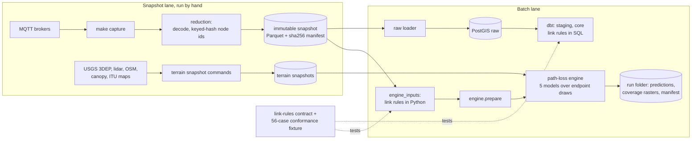

# mesh-terrain

Can public Meshtastic radio data tell us which radio propagation model best predicts link quality over real terrain? This project captured four days of public mesh traffic across the St. Louis metro, built a pipeline and a terrain-aware path-loss engine to answer that, and found that passive public data cannot answer it. The pipeline, the engine and the reasons are the result. [`docs/findings.md`](docs/findings.md) has the findings; this page says what was built and how to run it.

Meshtastic is an open-source mesh network of small LoRa radios. Some nodes, called gateways, forward everything they hear to an internet MQTT broker that anyone can read, with the received signal strength (RSSI) and signal-to-noise ratio (SNR) of the last radio hop. A propagation model predicts how much signal is lost between two points; comparing predictions with those readings is the test.

## What was built



- **Capture and pseudonymisation.** `make capture` records one MQTT capture on demand; nothing is scheduled. The reduction decodes the protobuf packets and replaces every node id with a keyed hash (HMAC-SHA-256) before anything is written to disk, so no real node id exists in the snapshot or the warehouse (ADR 0005). Each input, capture or terrain download, is an immutable snapshot with a sha256 manifest.
- **A contract and a conformance fixture.** The rules for turning packets into links (which radio hop a reading belongs to, which positions count, when a link-hour is kept) are written once in [`docs/data-quality-contract.md`](docs/data-quality-contract.md), 33 rules each named by an id such as `lnk_02`. A hand-worked fixture of 56 cases pins the expected outcome of every rule.
- **Two implementations.** The link rules run in SQL (dbt models in PostGIS) and in Python (`ingester/link_rules.py`). Both pass the fixture. On the real capture they agree on link-hours formed and kept, and on node pairs; they differ slightly at the receipt level, recorded in the findings.
- **Warehouse.** PostgreSQL 17 with PostGIS 3.5 and h3-pg, dbt for models and tests, Dagster for orchestration (ADR 0001). The tests connect as a role that cannot write the raw schemas at all.
- **Path-loss engine.** One command and one config file take a terrain snapshot, transmitter sites and receiver points, and write predictions, coverage rasters and a manifest. It runs five models: free space, knife-edge diffraction over the terrain profile, Okumura-Hata, the Longley-Rice Irregular Terrain Model (ITM, built from NTIA's public-domain reference code) and ITU-R P.1812. A real position is a box, not a point, so each link is predicted over random draws of both endpoints inside their boxes (16 in the runs so far), each box at least 5 m either side of its centre (ADR 0009). The contract is [`docs/INTERFACE.md`](docs/INTERFACE.md).
- **Provenance.** Every engine run's manifest records the code commit and whether the checkout was clean, the sha256 of every input layer and terrain snapshot manifest, the model library hashes, the seed and the versions of the manifest, the engine and the output columns. A run can be traced to exactly what produced it.
- **Privacy.** Node ids are pseudonymised at the source. Precise positions from the community broker are never published. The engine admits a point layer only if it is marked synthetic, or marked real and listed by the preparation step with a matching sha256. Run outputs from real data stay on the owner's machine; only counts are published.
- **Security.** Every published port is bound to localhost. The stack refuses to start with placeholder credentials. Credentials are generated per machine, never committed, and kept out of test reports. The details are in [`docs/operations.md`](docs/operations.md).

## Run it on synthetic data

You need Docker with Compose v2, GNU Make, [uv](https://docs.astral.sh/uv/) 0.13, Git and `openssl`. On Windows, run everything from Git Bash ([`docs/operations.md`](docs/operations.md), Running on Windows). These steps were run as written on a fresh clone: `make up` took about 4 minutes building the images, `make check` about 25 minutes.

```
git clone https://github.com/Caseykelly87/mesh-terrain.git
cd mesh-terrain
cp .env.example .env
# generate the stack's credentials in .env without printing them
for name in WAREHOUSE_PASSWORD MINIO_ROOT_USER MINIO_ROOT_PASSWORD; do sed -i "s|^${name}=.*|${name}=$(openssl rand -hex 24)|" .env; done
# a database role for the tests, with a distinctive name
sed -i "s|^# WAREHOUSE_TEST_USER=.*|WAREHOUSE_TEST_USER=tester_$(openssl rand -hex 6)|; s|^# WAREHOUSE_TEST_PASSWORD=.*|WAREHOUSE_TEST_PASSWORD=$(openssl rand -hex 24)|" .env
# the data folder lives beside the checkout, never inside it
mkdir -p ../mesh-terrain-data/snapshots ../mesh-terrain-data/runs
make up       # builds and starts PostGIS, the object store and Dagster
make check    # lint, types, about 1 850 tests and the dbt build, all on synthetic data
make engine CONFIG=engine/fixtures/fixture-run.yaml SNAPSHOTS_HOST_DIR="$PWD/tests/fixtures/snapshots"
make down     # stops the stack; the data is kept
```

The engine run writes `../mesh-terrain-data/runs/fixture/`: predictions, coverage rasters, a run report and a manifest recording the commit it ran from.

Notes:
- Ports 5433, 9000, 9001 and 3000 must be free; every one is bound to this machine only.
- Behind an antivirus or proxy that re-signs HTTPS, set `SSL_CERT_FILE`, `REQUESTS_CA_BUNDLE` and `CA_BUNDLE_PATH` in `.env` to its CA bundle ([`docs/operations.md`](docs/operations.md), Running on Windows).
- A second copy of the project on the same Docker host needs its own `COMPOSE_PROJECT_NAME` in `.env`, and must never run `make nuke`, which always acts on the `mesh-terrain` project's volumes.

The committed fixture run draws this coverage map: predicted knife-edge path loss from one synthetic site over a synthetic 1 km terrain tile. Nothing in it is real.


| Colour | Path loss, dB |
| --- | --- |
| yellow `#fde725` | below 60 |
| light green `#90d743` | 60 to 70 |
| green `#35b779` | 70 to 80 |
| teal `#21918c` | 80 to 90 |
| blue `#31688e` | 90 to 100 |
| indigo `#443983` | 100 to 110 |
| dark purple `#440154` | 110 or more |
| transparent | no value |

Free space at this frequency loses about 92 dB at 1 km, so the darkest cells are where the synthetic terrain blocks the path. How the figure is made, and the check that refuses any run with a real input layer: [`web/README.md`](web/README.md).

## Real versus synthetic

| Real, kept on the owner's machine | Synthetic, in this repository |
| --- | --- |
| The MQTT capture, 2026-10-22 to 2026-10-25, pseudonymised | Every test fixture and the conformance fixture |
| Terrain snapshots: USGS 3DEP, lidar, OpenStreetMap, canopy height, ITU maps (public sources, downloaded by make targets) | The engine fixture run: two sites, 500 receivers, a 1 km terrain tile |
| Engine runs on real positions | The coverage map above |

Published from real data: counts only (the funnel in the findings) and one coarse statement about the one link checked, which names no node, place, time or value.

## Limits

- One capture of four days, in one metro.
- About 8 usable node pairs, and one link-hour inside the terrain tile built at 1 m resolution.
- Positions from the public broker are blurred to hundreds of metres; transmit power and antennas are unknown; packets too weak to decode are never seen.
- The engine is tested against published reference values and a synthetic fixture, not against a controlled measurement. A drive test with known radios is the next phase ([`docs/ROADMAP.md`](docs/ROADMAP.md)).

## Where to look

| Path | What |
| --- | --- |
| [`docs/findings.md`](docs/findings.md) | The result |
| [`docs/PLAN.md`](docs/PLAN.md) | The original plan, phases and data model |
| [`docs/STATUS.md`](docs/STATUS.md) | Where the project actually stands |
| [`docs/ROADMAP.md`](docs/ROADMAP.md) | What comes next |
| [`docs/adr/`](docs/adr/) | One file per decision |
| [`docs/operations.md`](docs/operations.md) | Credentials, the test role, Windows, HTTPS interception |
| `ingester/`, `pipeline/`, `dbt/`, `terrain/`, `engine/`, `web/` | Each has a README |


## Contributing

How the work was organised and reviewed: [`CONTRIBUTING.md`](CONTRIBUTING.md). A check in a git worktree takes the test role's two values from the main checkout's `.env` and nothing else, in the same command as make, so they are never printed or copied ([`docs/operations.md`](docs/operations.md), Test role):

```
while IFS= read -r line; do export "$line"; done < <(grep -E '^WAREHOUSE_TEST_(USER|PASSWORD)=' "$(git rev-parse --path-format=absolute --git-common-dir)/../.env" | tr -d '\r') && make check DBT_DEV_TARGET=dev_ta
```

## Data credits

Elevation and lidar: USGS 3DEP (public domain). Canopy height: High Resolution Canopy Height Maps by WRI and Meta, version 2, CC BY 4.0 on the AWS Open Data registry and the DINOv3 licence. Buildings and roads: © OpenStreetMap contributors (ODbL). Boundary: US Census TIGER. ITM: NTIA reference implementation (public domain). Meshtastic packet data: one capture from the public broker and the MeshSTL regional broker under their terms of use, held privately; only counts are published.
